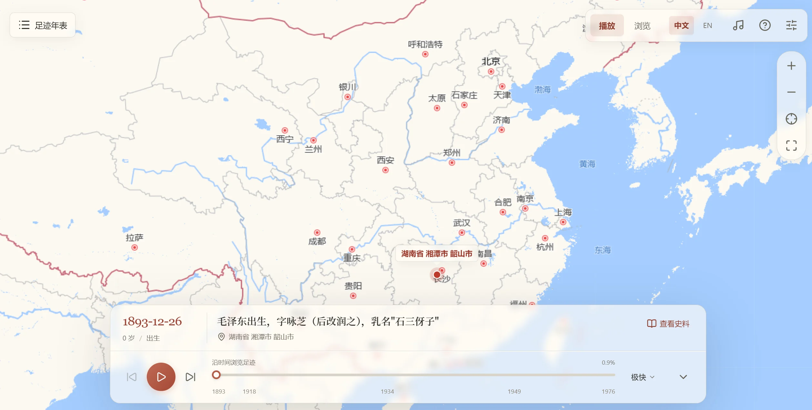
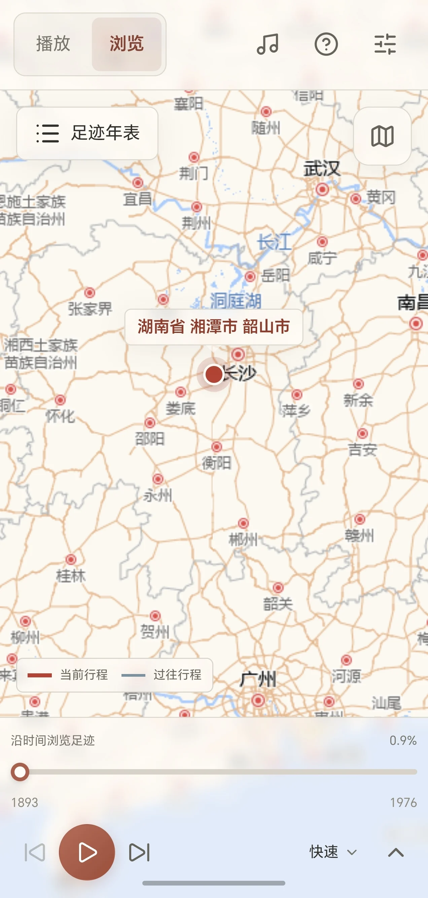

<div align="right">

[English](README_EN.md) | 中文

</div>

<div align="center">

# 📍 跟着教员走遍中国 - 毛主席足迹地图

[](#)
[](#)
[](https://sansan0.github.io/mao-map)
[](https://github.com/sansan0/mao-map/releases/latest)
[](https://github.com/sansan0/mao-map/releases/latest)
[](https://github.com/sansan0/mao-map/releases/latest)

</div>

> 读万卷书，行万里路

本项目通过数据可视化的力量，将毛泽东主席自 1893 年至 1976 年波澜壮阔的一生，浓缩于一张可交互的动态地图之上。让那段恢弘的历史"活"起来，清晰、生动地展现伟人在中国历史洪流中的每一个关键抉择与地理印记。

**在线体验：[https://sansan0.github.io/mao-map/](https://sansan0.github.io/mao-map/)**

**客户端下载：[GitHub Releases](https://github.com/sansan0/mao-map/releases/latest)**（Windows 安装包 / macOS DMG / Android APK）

<p align="center">
  
  <br />
  <sub>桌面播放模式</sub>
</p>

<p align="center">
  
  <br />
  <sub>手机浏览模式</sub>
</p>

## 🎯 核心功能

### 🎬 播放模式与可选皮肤

- **默认纯播放**：默认使用“纸色 · 暖调”和全屏地图，底部毛玻璃播放栏展示当前足迹；需要更少遮挡时可收起事件说明
- **按需浏览**：顶部切换“播放 / 浏览”；年表可展开或收起，手机端以抽屉呈现，史料可按需展开，地图工具默认收起
- **独立换肤**：设置中选择“经典 · 白与蓝”或“纸色 · 暖调”，两种皮肤均可搭配任一模式
- **统一磨砂**：设置中可实时调整“透明度”和“背景模糊”，默认 35% / 5px。播放和浏览模式以同一幅地图作为底层，顶部工具栏、播放栏、地图工具、侧栏与弹窗共用材质，选中底色随透明度变化，切换皮肤或模式时保留数值
- **保持进度**：切换模式、皮肤或收起说明不会中断播放
- **偏好记忆**：外观、模式、折叠、时期筛选、路线范围、镜头、速度、音量及内置歌曲选择自动保存在当前浏览器或应用本地，重开后恢复；播放保持暂停。清除站点或应用数据会清除这些偏好，本地上传的音乐仅用于当前会话

### 📖 足迹年表与史料阅读

- **按时期浏览**：从求学与探索到新中国岁月，按六个历史时期整理全部记录
- **检索足迹**：搜索年份、事件、起终地点和途经地点，选择记录后同步地图与时间轴
- **分层看路线**：切换“累计足迹”与“本次行程”，也可一键定位当前行程或查看截至当前的足迹范围
- **阅读史料**：当前事件卡展示日期、地点、行程和资料出处；未补充出处的记录会明确标注
- **跨端共用界面**：HTML、Windows、macOS、Android 共用界面结构；浏览模式可并排查看年表与地图，小屏及低高度窗口将年表收为抽屉

### 🎬 动态历史

- **时间轴播放**：点击 ▶️ 播放按钮，按时间顺序观看毛主席 83 年的人生轨迹动画
- **时间定位**：拖动底部的时间轴，可以快速定位到特定年份，查看当时的活动

### 🗺️ 交互式地图

- **多层级标记**：根据访问次数和事件类型智能显示不同样式的地图标记
- **详情面板**：点击地图上任意标记，查看该地点的完整历史事件列表
- **路径高亮**：点击事件列表项可高亮显示对应的移动路径

### 📊 数据统计

- **实时统计**：动态显示移动次数、访问省市、国际移动等数据
- **进度追踪**：实时显示当前播放进度、年龄、事件序号等信息
- **可视化图表**：直观展示历史轨迹的统计信息

### 🖥️ 桌面 & 移动客户端

基于 Tauri v2 构建，支持 Windows、macOS 和 Android：

- **系统托盘**（桌面端）：关闭窗口自动收入托盘，右键菜单支持置顶显示、开机启动
- **智能镜头跟随**：三种模式可选 —— 智能（距离自适应）、沿路（缓缓跟随路径）、关闭
- **统一速度控制**：单一速度档位同时控制播放、路径动画和镜头跟随
- **设置持久化**：语言、置顶、开机启动等偏好自动保存
- **Android 原生支持**：直接安装 APK，触屏交互优化

### PC 端快捷键

- **空格键**：播放 / 暂停
- **← / →**：前一个 / 后一个事件
- **Home / End**

## 💖 星星之火

无论你是发现了一个错误日期，还是想补充一段被遗漏的足迹，你的每一次贡献，都在让历史画卷更加完整。

感谢诸位同志为项目的完善做出的贡献：

<div align="center">
<table>
  <tr>
    <td align="center" width="150">
      <a href="https://github.com/sansan0/mao-map/issues?q=author:troilus">
        <br/>
        <sub>@troilus</sub>
      </a>
    </td>
    <td align="center" width="150">
      <a href="https://github.com/sansan0/mao-map/issues?q=author:9E307">
        <br/>
        <sub>@9E307</sub>
      </a>
    </td>
    <td align="center" width="150">
      <a href="https://github.com/sansan0/mao-map/issues?q=author:DoWhat6">
        <br/>
        <sub>@DoWhat6</sub>
      </a>
    </td>
  </tr>
</table>
</div>

每个考据者都可以在自己的考据中留下你对该事件的 comment, 你可以在 issues 中提交，由项目作者进行录入，以后考据的人多了，评论多了，我会做成弹幕在地图上滚动

```json
"userVerification": [
  // 支持多人协同考据
  {
    "username": "湘江史话", // 考据者署名 (可选)
    "comment": "一个注定将改变中华民族命运的伟人在韶山冲的农家小院中诞生。此时的中国正值内忧外患，列强瓜分，民族危亡之际。这个婴儿的啼哭声，仿佛是历史的回响，预示着一个新时代的到来。从韶山走向天安门，从农家子弟到开国领袖，毛泽东的一生将与中国人民的解放事业紧密相连，书写出波澜壮阔的历史篇章。", // 考据补充或感言 (可选)
    "date": "2025-06-30" // 考据日期 (可选)
  }
]
```

## 🚀 快速开始

本地预览网页端：

```bash
npm ci
npm run dev
```

打开 `http://127.0.0.1:51420/`。`/tauri.html` 可预览共用的客户端页面结构，原生窗口能力需要在 Tauri 中运行。

```bash
npm test       # 本地 DOM、数据、交互和静态资源路径验证，无浏览器自动化
npm run build # 生成 Tauri 使用的 dist/ 前端资源
```

GitHub Pages 继续直接使用仓库根目录的 `index.html`，并保留 `assets/`、`libs/`、`data/`、`i18n/` 等静态目录。两个入口通过 `assets/js/shell.js` 共用页面结构，均使用相对路径，支持 `/mao-map/` 子目录部署；网页端不需要运行 Tauri 构建，也不依赖服务器端渲染。底图瓦片仍需要网络，加载失败时可继续浏览年表并重试底图。

界面图标统一使用 [Lucide](https://lucide.dev/) 官方 SVG。`scripts/sync-icons.mjs` 从固定版本的 `lucide-static` 提取所需图标，运行 `npm run icons:sync` 可更新 `libs/lucide/`；该目录随静态网页和 Tauri 一起分发，无需访问图标 CDN。完整上游许可保存在 `libs/lucide/LICENSE`。

想要贡献或查看详细的参与方式？请查看 [贡献指南](CONTRIBUTING.md)。

## 📞 交流与联系

- **提交贡献/BUG**：请统一通过 [GitHub Issues](https://github.com/sansan0/mao-map/issues) 提交，这是追踪和处理问题最高效的方式。
- **交流与讨论**：欢迎关注公众号 **【硅基茶水间】**，分享你的想法。


## 🌟 项目愿景

**"古为今用"**，希望这个工具能成为大家学习历史、理解历史的得力助手。

## 📄 开源协议

本项目采用 [GPL-3.0 License](LICENSE) 协议开源，欢迎一切形式的分享与二次创作。
